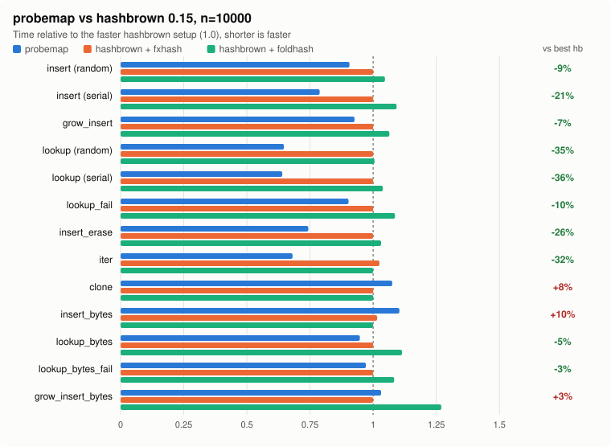
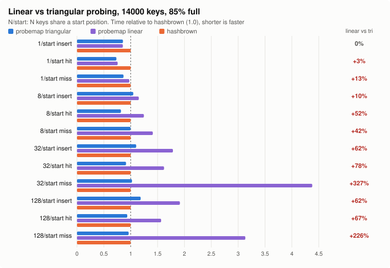

# probemap

A SwissTable hash map with direct SIMD — works on **stable Rust**.

## Features

- **Drop-in `HashMap` / `HashSet`** with the `std` API, including the entry API
- **SIMD on every major target**: SSE2 on x86_64, NEON on aarch64, SWAR (8 bytes as one `u64`) everywhere else
- **`KeyExtract` trait** — store only values when the key is embedded in the value
- **Pluggable `BuildHasher`** — default `AutoHasher` (FxHash for integers, an FxHash variant for byte slices that reads keys of 8 to 16 bytes with two loads), swap for any hasher
- **Custom allocator support** via `allocator-api2` (stable polyfill for the Allocator API)
- **`Send` / `Sync`** like `std` collections
- **Zero-cost empty table** — `new()` does not allocate, the first insert allocates 8 slots
- **Tombstone cleanup without growing** — delete-heavy workloads rehash in place instead of doubling
- **`reserve` / `try_reserve` / `shrink_to_fit`**, `with_capacity(n)` really holds `n` items
- **Bulk `memcpy` clone** for `Copy` types
- **87% load factor** with triangular group probing (`--cfg probemap_linear` switches to linear)

## Drop-in replacement for `std`

Change the import, the rest of the code stays the same:

```rust
// use std::collections::{HashMap, HashSet};
use probemap::{HashMap, HashSet};

let mut scores: HashMap<String, u32> = HashMap::new();
scores.insert("alice".to_owned(), 10);
*scores.entry("bob".to_owned()).or_insert(0) += 5;
scores.entry("alice".to_owned()).and_modify(|s| *s += 1);

assert_eq!(scores["alice"], 11);
assert_eq!(scores.get("bob"), Some(&5));
assert_eq!(scores.remove("bob"), Some(5));

for (name, score) in &scores {
    println!("{name}: {score}");
}

let seen: HashSet<u32> = [1, 2, 3].into_iter().collect();
let other = HashSet::from([2, 3, 4]);
assert_eq!(seen.intersection(&other).count(), 2);
```

Differences from `std` to know about:

- `HashMap<K, V>` needs `K: Hash + Eq` on the type itself, so `struct Foo<K> { m: HashMap<K, u32> }` needs that bound too
- lookups take `Q: Hash + Equivalent<K>` (as in hashbrown) instead of `K: Borrow<Q>`, `&str` for `String` keys works as usual
- `keys()`, `values()`, `extract_if()` and the set operations return `impl Iterator`, not named types like `hash_map::Keys`
- `insert` on an existing key replaces the key too, `std` keeps the old key
- `capacity()` is the number of items before the next grow, same as `std`

## Low-level `SwissTable`

```rust
use probemap::{KeyExtract, SwissTable, PairExtract};

// Simple (K, V) usage
type MyMap = SwissTable<PairExtract<u64, String>>;
let mut map = MyMap::new();
map.insert((42, "hello".to_string()));
assert_eq!(map.get(&42).unwrap().1, "hello");

// key_from_value pattern — key embedded in value
struct User { id: u64, name: String }

struct UserById;
impl KeyExtract for UserById {
    type Key = u64;
    type Value = User;
    fn extract(value: &User) -> &u64 { &value.id }
}

let mut users = SwissTable::<UserById>::with_capacity(64);
users.insert(User { id: 1, name: "Alice".into() });
assert_eq!(users.get(&1).unwrap().name, "Alice");
```

### Custom hasher

```rust
use probemap::{SwissTable, PairExtract, FxBuildHasher};
use std::collections::hash_map::RandomState;

// Use FxHasher directly
let map = SwissTable::<PairExtract<u64, u64>, FxBuildHasher>::with_hasher(FxBuildHasher);

// Use SipHash (DoS-resistant)
let map = SwissTable::<PairExtract<String, u64>, RandomState>::with_hasher(RandomState::new());
```

## `SwissTable` API

| Method | Description |
|---|---|
| `new()` / `new_in(alloc)` | Empty table (no allocation) |
| `with_capacity(n)` / `with_capacity_in(n, alloc)` | Pre-allocate for `n` elements |
| `with_hasher(S)` | Empty table with custom hash builder |
| `with_capacity_and_hasher(n, S)` | Pre-allocate with custom hash builder |
| `with_hasher_and_alloc(S, A)` | Custom hash builder + custom allocator |
| `insert(value)` | Insert or update by key |
| `replace(value)` | Insert or update, returns the old value |
| `get(key)` / `get_mut(key)` | Lookup by key |
| `remove(key)` | Remove by key (returns `bool`) |
| `take(key)` | Remove by key, returns the value |
| `contains(key)` | Key existence check |
| `get_or_insert(value)` | Get existing or insert new |
| `get_or_insert_with(key, f)` | Get existing or build and insert the value lazily |
| `retain(f)` / `extract_if(f)` / `drain()` | Remove many values |
| `reserve(n)` / `try_reserve(n)` / `shrink_to_fit()` | Memory control |
| `clear()` | Drop all values, keep allocation |
| `clone_table()` / `clone()` | Deep copy |
| `iter()` / `iter_mut()` / `into_iter()` | Iterators, all `ExactSizeIterator` |
| `prefetch(key)` | Hint CPU to preload cache lines |
| `hasher()` | Reference to the hash builder |
| `allocator()` | Reference to the allocator |
| `len()` / `is_empty()` / `capacity()` | Size queries |

Also implements `Extend`, `FromIterator`, `IntoIterator` (owned, `&`, `&mut`), `Debug`, `Clone`, `Default`, `PartialEq`.

## Benchmarks (vs hashbrown 0.15, n=10000)

Median time for 10 000 operations, lower is better. The last column compares probemap with the faster of the two hashbrown setups.



| Benchmark | probemap | hb+fxhash | hb+foldhash | vs best hashbrown |
|---|---|---|---|---|
| insert (random) | **58.2 µs** | 64.2 µs | 67.2 µs | **-9%** |
| insert (serial) | **46.1 µs** | 58.5 µs | 63.9 µs | **-21%** |
| grow_insert | **196.6 µs** | 212.3 µs | 225.9 µs | **-7%** |
| lookup (random) | **30.9 µs** | 47.7 µs | 47.9 µs | **-35%** |
| lookup (serial) | **29.4 µs** | 45.9 µs | 47.7 µs | **-36%** |
| lookup_fail | **32.5 µs** | 36.0 µs | 39.1 µs | **-10%** |
| insert_erase | **133.5 µs** | 179.5 µs | 185.2 µs | **-26%** |
| iter | **8.1 µs** | 12.3 µs | 12.0 µs | **-32%** |
| clone | 12.3 µs | 11.4 µs | 11.4 µs | +8% |
| insert_bytes | 167.4 µs | 154.0 µs | 151.6 µs | +10% |
| lookup_bytes | **104.4 µs** | 110.2 µs | 122.8 µs | **-5%** |
| lookup_bytes_fail | **64.1 µs** | 66.0 µs | 71.5 µs | **-3%** |
| grow_insert_bytes | 308.9 µs | 299.5 µs | 380.4 µs | +3% |

Setup: Intel Core i5-11400F, Linux, `target-cpu=native` (from `.cargo/config.toml`), criterion 0.5, `cargo bench --bench bench`.
`*_bytes` benchmarks use 16-byte `Vec<u8>` keys, the rest use random or serial `usize` keys. `insert_bytes` reuses one warm table, clears it and clones the keys outside the timing, so it measures the table and not `malloc`. probemap uses its default hasher, with the same `FxBuildHasher` as `hb+fxhash` the byte results are: insert_bytes +9%, lookup_bytes -5%, lookup_bytes_fail -4%, grow_insert_bytes +3% (the `probemap_fx` rows in the bench).
All tables fit in CPU cache at this size, results for tables much larger than cache may differ.
Single runs move by a few percent depending on where the linker puts the hot loops, compare with that in mind.

### Linear vs triangular probing

probemap probes groups triangularly, the step grows by one group every time (`+16`, `+32`, `+48` …), like hashbrown.
Linear probing (`+16` every time) reads the neighbouring group, which is kinder to the cache, but when many keys
start at the same place the runs of full groups merge and every lookup walks the whole run.
`benches/probing.rs` forces that: 14 000 keys in a table 85% full, N keys share each start position.



| keys per start | operation | triangular | linear | linear vs triangular | hashbrown |
|---|---|---|---|---|---|
| 1 | insert | 121.2 µs | 120.9 µs | 0% | 141.6 µs |
| 1 | lookup hit | 90.2 µs | 93.1 µs | +3% | 123.0 µs |
| 1 | lookup miss | 302.4 µs | 340.2 µs | +13% | 349.2 µs |
| 8 | insert | 256.0 µs | 281.3 µs | +10% | 244.4 µs |
| 8 | lookup hit | 175.6 µs | 267.4 µs | +52% | 214.6 µs |
| 8 | lookup miss | 531.7 µs | 752.9 µs | +42% | 533.2 µs |
| 32 | insert | 421.7 µs | 683.3 µs | +62% | 382.6 µs |
| 32 | lookup hit | 373.2 µs | 662.7 µs | +78% | 409.0 µs |
| 32 | lookup miss | 780.8 µs | 3337.9 µs | +327% | 762.4 µs |
| 128 | insert | 725.5 µs | 1173.1 µs | +62% | 612.3 µs |
| 128 | lookup hit | 670.1 µs | 1121.8 µs | +67% | 716.3 µs |
| 128 | lookup miss | 1218.5 µs | 3970.0 µs | +226% | 1267.0 µs |

With a good hash and no clusters both are within a few percent. With clusters linear probing is up to 4x slower.
The same effect made copying one table into another by iteration slow with linear probing: 100 000 keys took
28 ms instead of 5.4 ms (hashbrown 5.1 ms). Rerun it with:

```sh
cargo bench --bench probing
RUSTFLAGS="-C target-cpu=native --cfg probemap_linear" CARGO_TARGET_DIR=target-linear cargo bench --bench probing
```

## Why faster than hashbrown?

Both probemap and hashbrown implement the same SwissTable algorithm and use the
same SIMD intrinsics. The performance difference comes from how the surrounding
code is structured.

**Monomorphized key comparison vs `dyn FnMut`.**
hashbrown's inner lookup (`find_inner`) takes the key comparator as
`&mut dyn FnMut(usize) -> bool` — a trait object. This means every key
comparison in the probe loop is an indirect call through a vtable pointer.
The CPU cannot predict it, and LLVM cannot inline through it. This is a
deliberate trade-off in hashbrown to reduce binary size from monomorphization.
probemap calls `E::extract(slot) == key` directly — the compiler monomorphizes
the comparison for each concrete type and inlines it into the probe loop,
eliminating the indirect call overhead entirely. This is likely the single
biggest contributor to the ~30% lookup speedup.

**Forward slot layout.**
hashbrown stores slots in reverse order relative to control bytes
(`base.sub(index)`). probemap uses forward order (`slots.add(index)`). Modern
CPUs prefetch forward; reverse indexing works against the hardware prefetcher.

**Flatter data path.**
hashbrown has four layers: `HashMap` -> `HashTable` -> `RawTable` ->
`RawTableInner`. `RawTableInner` type-erases the value to `*u8` and reconstructs
`Bucket<T>` through pointer arithmetic. probemap is a single struct with inline
methods — no type erasure, no `Bucket` wrapper, no intermediate layers.

**Mirrored control bytes.**
The first 16 control bytes are duplicated at the end of the array, so an
unaligned SIMD load near the end wraps around without sentinel bytes or
branches. Probing is triangular (`stride += 16; pos += stride`), the extra add
per step costs nothing measurable and keeps colliding keys from merging into
long runs, see [Linear vs triangular probing](#linear-vs-triangular-probing).

**Cheap growth.**
A freshly allocated table has no tombstones, so the move loop finds a free slot
with a single `movemask` (EMPTY or DELETED) instead of comparing every byte with
EMPTY. Counters are written once at the end, and the table switches to the new
buffer only after every value is moved, so a panicking hasher leaves the old
table intact. The rare grow path lives in a `#[cold]` function, so `insert`
stays small enough to be inlined into the caller's loop.

**Tombstone cleanup in place.**
When deletes fill the table with tombstones and the live set is at most half of
the load budget, the table is rehashed inside the same buffer instead of
doubling, so insert/remove churn does not grow memory.

**Pointer-based iterator.**
The iterator keeps pointers to the current control group and slot group, moves
both by one group at a time and stops as soon as the remaining item counter
hits zero, without checking the end of the table.

**Bulk `memcpy` clone.**
`clone_table()` checks `needs_drop::<V>()` at compile time. For `Copy` types
the entire slots array is a single `memcpy` — no per-element loop, no rehash.

## Caveats

- **Hash quality.** The default hasher is fast, not DoS-resistant. Use `RandomState` for untrusted keys

## Requirements

- **Rust edition 2024** (1.85+)
- Stable toolchain (no nightly features required)
- SSE2 on x86_64, NEON on little-endian aarch64, portable SWAR fallback on other targets

## License
Apache License
